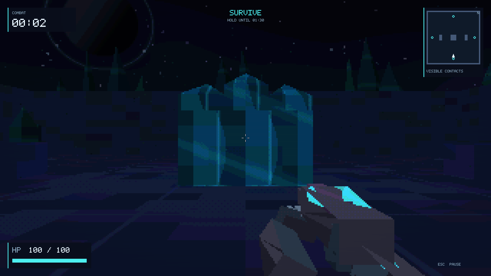

# 星空晶体竞技场：实施与验收记录

2026-10-07，用户授权由 ATLAS 调度团队完整实施
[两分钟样片计划](../plan/two-minute-sample.md)。本记录区分工程证据与人类试玩，
只将实际执行过的检查标记通过。

状态：**开发与自动化工程验收完成，人工耳机试听及五人试玩待完成**。
这是可玩的样片交付，尚未满足计划的完整人工验收门槛。
启动和操作见 [中文说明](../README_CN.md)。

本页记录地图重构前的样片验收及其二进制；后续地图系统和独立编辑器改造的
当前证据另见 [地图与编辑器升级](map-editor-upgrade.md)。两轮结果分别保留。



## 基线

- 本机：Apple M2 MacBook Air，16 GB 内存，Retina 显示屏。
- 开始实施前，Debug / Release 的原有 Phase 0 测试均通过。
- 开始实施前记录 561 个已有文件的 SHA-256，保留既有工作区改动。
- 各角色文件所有权见 [团队索引](agent-team.md)。

## 工程验收矩阵

| 检查 | 必须验证的行为 | 状态 / 证据 |
| --- | --- | --- |
| 构建与回归 | Debug、Release、原测试与新行为测试 | 最终 Debug/Release 完整构建与测试通过，包含两类导航边界回归 |
| 导演 | 30/60/144 FPS 与不规则步长、同输入同 seed、预警、安全重试、数量上限、90s 取消、清场胜利 | 纯逻辑与实际 Enemy 回归通过；完整自动战斗胜利基线通过 |
| 战斗 | Chaser 绕障/分离；Sentry 可见性、追踪/锁定/恢复；敌弹最近扫掠命中与实际伤害 | 测试通过；顶部目标额外 64 组合回归保持地面碰撞约束 |
| 状态 | READY、焦点丢失暂停、恢复鼠标、1s 结果锁、按住开火不能误重开 | 实际 App/GL/audio 合成输入 flow-final 共 10 项通过；不是人类操作观察 |
| 统计 | 每类击杀、命中率、实际扣血、致死来源、生成延误/取消、seed/content version JSONL | 统计回归、实际致死流程及三局 JSONL 通过；每局记录 32 Chasers / 3 Sentries，合成输入明确标记 |
| 地图 | 连通、安全、外圈通道、36x36、旧地图可加载 | 4870 个采样安全格连通；真实旧贴图地图加载/退出成功；最终导航回归通过 |
| 画面 | 星空、晶体、人物与武器、预警可读、45s/4s 异变无玩法变化 | 模块真实 GL 与整局截图通过；后处理暗部网格已减弱，实战威胁识别人测待完成 |
| UI | 原创 5x7、1280x720、800x600、Retina、resize、后处理之后、可见性过滤 | 逻辑测试、两尺寸 Retina 夹具及整局截图通过；直接 OS 键鼠操作未验证 |
| 音频工程 | 预加载、24/8 声部、优先级、定位参数、暂停与重开清理、失败降级可见 | 模块离线验证及整局真实设备回调、暂停和重开通过；[模块证据](../tools/audio/VALIDATION.md)，耳机听感待完成 |
| 50 次实际重开 | GL/audio/runtime 全系统；实体/弹体/预警/声音/统计清理，热身后内存趋势 | 最终二进制 restarts-v3 50 次通过，25 次活跃预警；另 150 次同步长循环通过，详见下方内存记录 |
| 性能 | Release、VSync off、三次完整运行；p95 <=20ms、p99 <=33.3ms、无连续三帧 >50ms | performance-v2 三局通过，详细数值见下表 |
| 压力 | 18 Chasers + 3 Sentries + 32 敌弹 + 2000 环境粒子 | stress-final 约 30 秒通过，真实加载数量记录与逐帧 CSV 已保留 |
| 资源 | 原创生成器、依赖版本、许可证、校验值、音频无战斗时文件 I/O | 13 个原创 WAV 可重复生成、启动预加载；miniaudio 0.11.25 来源/许可证/校验已交付，见 [来源记录](../third_party/miniaudio/PROVENANCE.md) |
| 平台 | 本机 macOS 运行；Windows/Linux 构建结构保留 | 跨平台运行待验证 |

## 最终性能与独立复核

Release，M2 MacBook Air，1280×720 逻辑窗口、2560×1440 Retina framebuffer、
320×200 场景渲染，关闭 VSync，真实音频设备回调开启。以下数值由 ATLAS 从
原始逐帧 CSV 重新计算，与运行时 JSONL 一致。

| 场景 | 战斗秒数 | 帧数 | p95 ms | p99 ms | 最大 ms | 最长连续 >50ms 帧数 |
| --- | ---: | ---: | ---: | ---: | ---: | ---: |
| 完整运行 1 | 90.003 | 46149 | 7.475 | 8.554 | 53.614 | 1 |
| 完整运行 2 | 90.001 | 44499 | 7.456 | 8.548 | 124.172 | 1 |
| 完整运行 3 | 90.001 | 42198 | 7.535 | 9.847 | 103.734 | 1 |
| 满负载约 30 秒 | 29.959 | 14134 | 6.137 | 7.374 | 55.856 | 1 |

三次完整运行均清场获胜，记录 32 个 Chasers 和 3 个 Sentries。
存在表中孤立慢帧，但没有三帧连续超过 50ms，符合已定门槛。
自动运行使用合成移动/瞄准与无敌，射击和碰撞仍经过实际系统；这些成绩只证明
工程路径和测量负载，不能推导玩家难度、命中率、可读性或重玩意愿。
压力场景记录实际 18 Chasers、3 Sentries、32 敌弹、2000 环境粒子。

[机器可读摘要](acceptance/sample-engineering.json) 包含逐局数值、分辨率、
十项流程检查、最终 Release SHA-256 与核心源文件校验值。
性能、压力和最终重开三类记录的二进制 hash 相同，并与验收时的 `silic2-release`
在该次样片验收时独立核对一致。Debug/Release 构建日志、原始 CSV/JSONL 和截图留在本机
`artifacts/acceptance`；这些生成文件被 Git 忽略，摘要和代表截图随文档保留。

本机证据复核命令：

```bash
python3 tools/acceptance/check_evidence.py \
  --restarts artifacts/acceptance/restarts-v3 \
  --performance artifacts/acceptance/performance-v2 \
  --stress artifacts/acceptance/stress-final
```

复跑游戏验收入口见 README；该独立复核器还要求各目录保存同一版本的
`binary.sha256`（运行前可用 `shasum -a 256 silic2-release` 记录）。
后续重新编译时当前二进制可能变化，应重新生成整套证据，不能混用旧 hash。

## 重开与内存诊断证据

原始记录保留在本地 `artifacts/acceptance`（生成文件，不纳入源码）：

- `restarts-v1`：因窗口失焦暂停而中断，不计验收。
- `restarts-v2`：50 次状态清理通过，但异步采样 RSS 呈上升，未直接判内存通过。
- `restarts-sync-150`：仅在重开内存采样前等待 GPU 完成，连续 150 次，
  151 个干净状态记录，75 次重开前有活跃预警；热身后 RSS 约 66.38–70.34 MiB，
  末次比热身后起点低约 3.53 MiB，无持续上升。中途取过一次 vmmap，保留这一限制。
- `restarts-final`：不附加分析器的 50 次标准复核，51 个干净状态记录，25 次
  覆盖活跃预警；热身后 RSS 70.21875–70.375 MiB，末次与起点差 0.125 MiB，
  未观察到持续增长。真实音频回调、玩家/敌方弹体、敌人、声音和伤害统计均参与循环。
- `restarts-v3`：最后导航修复后的同一最终二进制再次完成 50 次重开，51 个干净
  状态记录、25 次活跃预警。独立复核排除初始状态及前 10 次重开后，RSS 为
  67.90625–69.828125 MiB，末次比起点低 1.40625 MiB，回归斜率约
  -39.3 KB/次。实体、两类弹体、效果、声音、统计、导演和环境时间全部归零，
  HP 恢复 100、致死来源重置。未观察到持续增长。

以上支持异步 GPU/缓存影响采样的解释，但没有唯一定位某一驱动分配。
`glFinish` 只用于重开诊断采样，不加进正常战斗或性能测量路径。
清理计数通过与内存趋势通过分别检查；短时 RSS 稳定也不等于对所有长期泄漏的证明。

独立审阅指出 Chaser 导航边距造成贴墙停追、玩家跳上侧掩体后目标不可达，以及
旧贴图地图退出时 TextureManager 缓存晚于 GL 上下文释放。这三项均已修复。
顶部目标增加 64 组合回归：双侧掩体 × 四裂隙 × 两种顶部高度 × 四种帧步，
验证接近可达边缘、逐帧不穿障碍，以及目标回到地面后恢复追击。

## 输入验证范围

`flow-final/flow.jsonl` 的 10 项检查运行在真实 App、GL 和音频循环中，合成按键
进入普通输入处理分支，涵盖 READY 排除时间、Esc 暂停/恢复、音频冻结、焦点回调、
鼠标捕获、实际致死伤害、结果锁、持有射击和新点击同 seed 重开。
这不是仅调用 RunController 的单元测试，也不是人类按键试玩。

ATLAS 尝试通过桌面 UI 工具操作额外普通窗口，但工具无法识别未打包的 GLFW
可执行程序，未完成直接 OS 键鼠复查；该尝试不计通过。临时进程已结束。

## 人工验收

耳机方向、叠音、听感可读性及五名玩家试玩需要实际观察。自动循环、录音生成、
模拟玩家或代码审查不计作人类试玩。未收集结果前，里程碑只可标为
“工程验收完成，人工试玩待完成”，不能标为全部验收通过。

每位玩家在同一 Mac、耳机、默认 seed 下先玩两局，再独立选择是否开始第三局。
只解释游戏内操作；不要提前教敌人解法。记录玩家原话与行为，将策划解读另列。

| 玩家 | 第一局日志 / 结果 | 第二局日志 / 结果 | 伤害来源解释（原话） | 是否改进 / 依据 | 自愿第三局 | 阻塞或重开问题 |
| --- | --- | --- | --- | --- | --- | --- |
| P1 | 待观察 | 待观察 | 待观察 | 待观察 | 待观察 | 待观察 |
| P2 | 待观察 | 待观察 | 待观察 | 待观察 | 待观察 | 待观察 |
| P3 | 待观察 | 待观察 | 待观察 | 待观察 | 待观察 | 待观察 |
| P4 | 待观察 | 待观察 | 待观察 | 待观察 | 待观察 | 待观察 |
| P5 | 待观察 | 待观察 | 待观察 | 待观察 | 待观察 | 待观察 |

门槛：4/5 能正确解释主要伤害/死亡来源；3/5 第二局改善；3/5 自愿第三局；
无阻塞、错误结算或重开状态泄漏。失败玩家以到达更后波次或首次胜利算改善；
两局都胜利者须受伤降低 >=10%，或清场时间降低 >=10% 且受伤不增加。
单纯存活更久不足以认定改善。
